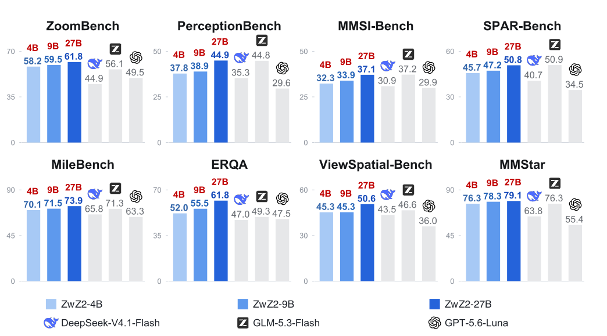
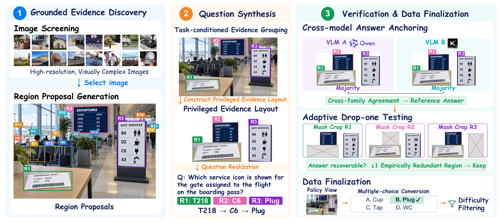
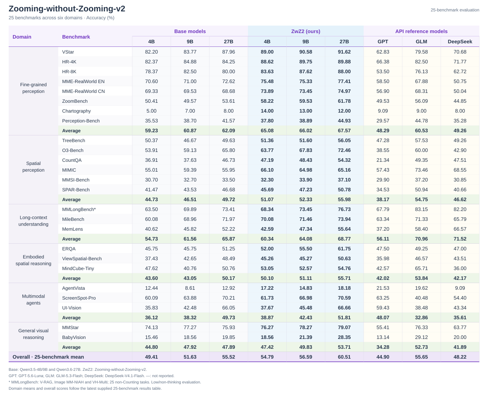

# Zooming without Zooming v2 (ZwZ-v2)

## ✨ Introduction

**Zooming without Zooming v2** connects fine-grained visual evidence across regions.
We train **ZwZ2-4B/9B/27B** with reinforcement learning on 20.4K verified,
multi-region VQA examples. Training uses full images; inference needs no zooming tools.
The models transfer across perception, spatial reasoning, long-context understanding
and multimodal agents.

<p align="center">
  <a href="assets/zwz-v2-overview.pdf"></a>
</p>

## ⚙️ Method

**EvidenceConnect** turns evidence from 3–7 image regions into verifiable supervision:

1. Discover grounded regions and synthesize questions that connect their evidence.
2. Verify answers through cross-model agreement and adaptive region-ablation tests.
3. Train on the full-image view with GRPO, without supervised fine-tuning.

<p align="center">
  
</p>

## 📊 Performance

Results on **25 benchmarks across six domains** (accuracy, %).

<p align="center">
  
</p>

## 🤗 Models and Data

| Model | Base model |
| --- | --- |
| ZwZ2-4B | Qwen3.5-4B |
| ZwZ2-9B | Qwen3.5-9B |
| ZwZ2-27B | Qwen3.6-27B |

All three scales use the same **20.4K training examples**, synthesized from SA-1B
images with cross-model verification. Privileged crops are used during data
construction only; the policy learns from the full-image view.

## 🚀 Getting Started

| Component | Directory |
| --- | --- |
| Data synthesis | [`data_synthesis/`](data_synthesis/) |
| Training | [`verl/`](verl/) |
| Evaluation | [`eval/`](eval/README.md) |

## 1. Data synthesis (`data_synthesis/`)

### Setup

```bash
cd data_synthesis
cp configs/local_env.sh.example configs/local_env.sh   # then edit keys/model names
pip install openai httpx pillow pyarrow pytest
```

Set your API URL, keys and model names in `configs/local_env.sh` (gitignored).

### Run

The only input is a folder of images:

```bash
# 1) Stage 01 — scan the image folder, build a manifest, and drop
#    low-content images (resolution / entropy / edge density / std-dev):
python scripts/01_filter_manifest.py \
    --image_folder /path/to/images \
    --output_jsonl data/filtered_manifest.jsonl

# 2) Continuous synthesis over the filtered manifest:
bash run_pipeline_continuous.sh [TARGET_VALID] [BATCH_SIZE] [MAX_BATCHES] [MANIFEST]
#    MANIFEST defaults to data/filtered_manifest.jsonl (the stage-01 output)
```

### Export training data

The synthesized records are exported to a verl-ready parquet for RL training:

```bash
python scripts/05_export_dataset.py \
    --validated_jsonl data/all_valid.jsonl \
    --output_parquet  mcq_train.parquet \
    --format mcq
```

`--format mcq` is the multiple-choice format consumed by the training
launchers below. Any verl-format validation parquet can be used as the
evaluation set.

### Tests

```bash
pytest -q tests/
```

---

## 2. Training (`verl/`)

Train with GRPO using [verl](https://github.com/volcengine/verl).
Choose the launcher for your base model:

| Model | Script |
| --- | --- |
| Qwen3.5-4B  | `verl/train_zwz2_qwen3_5_4b.sh`  |
| Qwen3.5-9B  | `verl/train_zwz2_qwen3_5_9b.sh`  |
| Qwen3.6-27B | `verl/train_zwz2_qwen3_6_27b.sh` |

### Setup

```bash
pip install -e ./verl   # install the vendored verl framework
```

### Run

Set the model and dataset paths:

```bash
cd verl
MODEL_PATH=/path/to/Qwen3.5-9B \
TRAIN_FILE=/path/to/mcq_train.parquet \
TEST_FILE=/path/to/val.parquet \
bash train_zwz2_qwen3_5_9b.sh
```

Run the same way for the other sizes; checkpoints, logs and rollout dumps are
written under `outputs/<experiment-name>/` (override with `EXPERIMENT_ROOT`).

---

## 🧪 3. Model Evaluation (`eval/`)

```bash
cd eval
python -m pip install -e '.[api,data]'
```

### 1. Configure

```bash
python -m zwz_eval init --directory local/my-eval --bench hr4k,hr8k
```

Edit `local/my-eval/model.json` with your model/judge paths, identities, GPU settings
and output directory. Set downloaded annotation/image paths and input formats in
`local/my-eval/datasets.json`. Replace all example values before running.

### 2. Prepare data

Download and extract the benchmarks, then prepare them:

```bash
bash scripts/prepare_benchmarks.sh local/my-eval
```

This writes `local/my-eval/ready.json` without modifying the original downloads.

### 3. Evaluate

```bash
bash scripts/evaluate.sh local/my-eval
```

The command evaluates the configured benchmarks serially, managing model startup,
inference, required judging and service cleanup. To select a subset, append IDs
such as `hr4k,hr8k`.

### Benchmark data format

MMStar, BabyVision, VStar, HR-4K, HR-8K, MME-RealWorld-en/cn, ZoomBench,
Perception-Bench, TreeBench, O3-Bench and CountQA require JSONL or a JSON array
with `images`, `query` and `response` fields:

```json
{
  "images": ["/path/to/images/image.png"],
  "query": "<image>Original question and answer choices",
  "response": "Reference answer"
}
```

Use `format: normalized` for these benchmarks; keep original questions, answers,
image order and optional fields unchanged. Other benchmarks use their downloaded
formats. See [eval/README.md](eval/README.md) for the benchmark ID table, download
instructions, data formats and optional API settings. AgentVista uses the same
workflow and additionally requires Internet access for search/visit tools.

---

## 🙏 Acknowledgments

This project builds upon:

- Qwen3.5 and Qwen3.6 for the base models.
- [verl](https://github.com/volcengine/verl) for the RL training framework.

## 📮 Contact

For questions or collaborations, please contact:

- Lai Wei: [waltonfuture@sjtu.edu.cn](mailto:waltonfuture@sjtu.edu.cn)
- Yatai Li: [zenith-knecht@sjtu.edu.cn](mailto:zenith-knecht@sjtu.edu.cn)
- Liangbo He: [liangbo.hlb@antgroup.com](mailto:liangbo.hlb@antgroup.com)
- Jun Lan: [yelan.lj@antgroup.com](mailto:yelan.lj@antgroup.com)
- Zhuosheng Zhang: [zhangzs@sjtu.edu.cn](mailto:zhangzs@sjtu.edu.cn)
- Weiran Huang: [weiran.huang@sjtu.edu.cn](mailto:weiran.huang@sjtu.edu.cn)

If you encounter issues with dataset paths or evaluation setup, please share your
feedback or contributions. Thank you for your support!

## 📄 License

Apache License 2.0. See [LICENSE](LICENSE).
